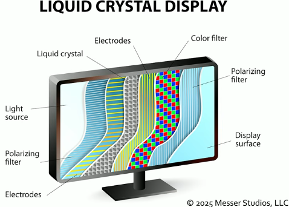
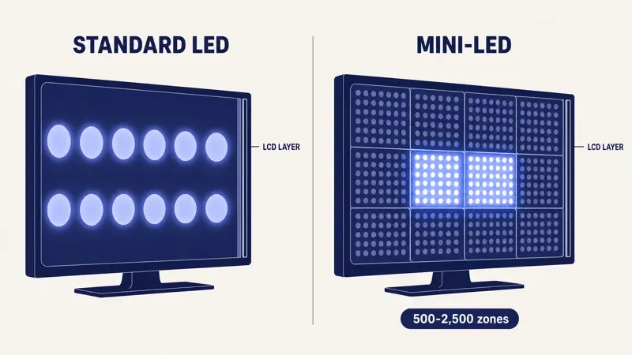
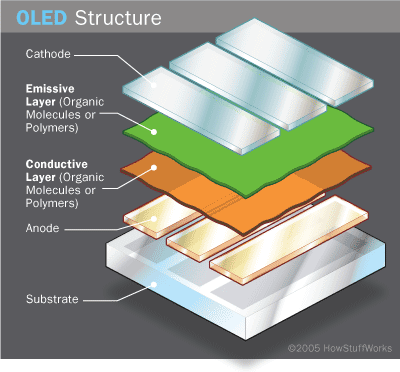
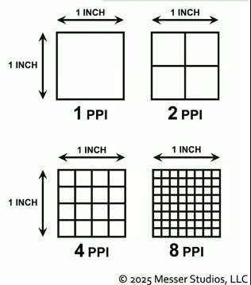
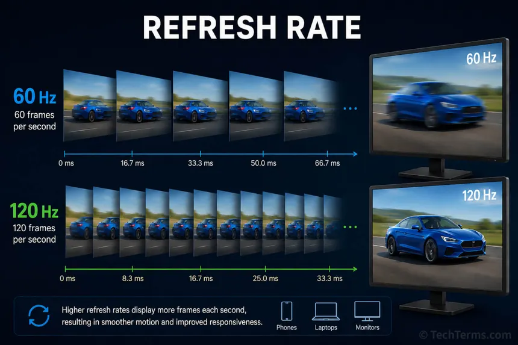
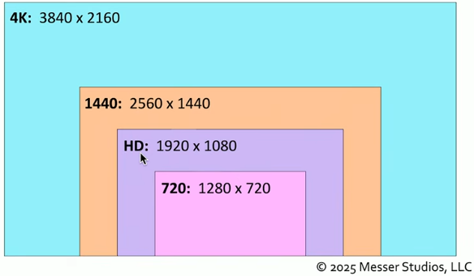
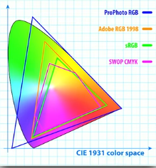

# **Display**

## **Types**

### **LCD**

#### Liquid Crystal Display

- Light shines through liquid crystals
- Lightweight
- Relatively low power
- Relatively inexpensive

#### TN (Twisted Nematic) LCD

- The original LCD technology
- Face response times (gaming!)
- Poor viewing angles - color shifts

#### IPS (In Plane Switching) LCD

- Excellent color representation
- Can be more expensive to produce than TN
  
#### VA (Vertical Alignment) LCD

- A good compromise between TN and IPS
- Good color representation
- Often slower response times than TN

 

### **Mini LED**

#### Mini Light Emitting Diode
  
- Same backlight technology as a conventional LED-backlit LCD
  - But much smaller LEDs
- Each LED can be enabled or disabled
  - And color and intensity can be different
- Much better control over dark screen areas
  - Deeper blacks, better color representation

 

### **OLED**

#### Organic Light Emitting Diode

- Organic compound emits light when receiving an electric current  
- No backlight
- Thinner and lighter
- Very accurate color representation
- Tends to be a bit higher cost than LCD

## **Display Attributes**

### **Pixel Density**

  $$ pixels / inch = PPI $$

- Measure how many pixels in an inch
  - Or pixels per centimeter
  - Apply a physical measurement to a display
- A higher pixel density looks better
  - higher clarity and sharpness
- Consider how the image will be viewed
  - Displays
  - Printers (dots per inch)
- Number of pixels / Number of inches
  - pixels per (divided by) inch

 

### **Refresh Rates**

- Usually measured in hertz (Hz)
  - Number of cycles per second
  - Frames per second (FPS)
- Frame rates may vary
  - Movies: 24 fps
  - Television: 30 fps
  - Video games: 60+ fps
- Refresh rate limiting factors
  - Adapter/processor
  - Display device
  - Ports/Connection

 

### **Screen Resolution**

$$ Width X height $$

 

### **Color Gamut**

CIE 1931 color space

- Standards
  - sRGB - Standard Red Green Blue
  - Adobe RGB
  - International Telecommunication Union (ITU) standards for HDTV
