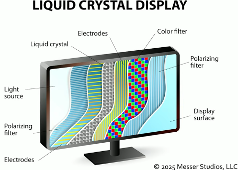

# **Display**

## **LCD**

### Liquid Crystal Display

- Light shines through liquid crystals
- Lightweight
- Relatively low power
- Relatively inexpensive

### TN (Twisted Nematic) LCD

- The original LCD technology
- Face response times (gaming!)
- Poor viewing angles - color shifts

### IPS (In Plane Switching) LCD

- Excellent color representation
- Can be more expensive to produce than TN
  
### VA (Vertical Alignment) LCD

- A good compromise between TN and IPS
- Good color representation
- Often slower response times than TN
